<picture>
  <source media="(prefers-color-scheme: dark)" srcset="assets/readme/hero-dark.svg">
  <source media="(prefers-color-scheme: light)" srcset="assets/readme/hero-light.svg">
  
</picture>

# Velkin

   

**Velkin fait tourner des jeux Xbox Series X|S sur un PC Windows équipé d'une carte NVIDIA.** C'est un fork de [Kelvaroq](https://github.com/stellarr-studio/kelvaroq), de Stellarr Studio SAS, dont le moteur natif reposait sur VIctory et victory-fork. Depuis le 28 novembre 2026, le moteur de Velkin est construit sur VIctory-NVIDIA, qui s'est montré le plus rapide et le plus stable sur une RTX 3060. Velkin part de cette base, la plus avancée sur NVIDIA au moment du fork, et y ajoute ce qui marche le mieux chez VIctory, XCL et leurs forks, plus ses propres améliorations.

> [!IMPORTANT]
> **Il vous faut votre propre exemplaire du jeu.** Velkin ne contient et ne distribue aucun fichier de jeu, aucun code de jeu, aucune ressource, aucune clé ni aucun lien de téléchargement. Il lance seulement un jeu que vous possédez et que vous avez installé vous-même depuis votre copie légale. Les demandes de fichiers, de clés, de dumps ou de liens sont refusées et supprimées.

> [!NOTE]
> **Velkin n'est pas Kelvaroq** et n'est ni soutenu ni approuvé par Stellarr Studio SAS. Les mesures publiées par le projet Kelvaroq portent sur son propre code et son propre matériel. Velkin ne les reprend pas à son compte : il ne publie que les chiffres mesurés sur ses propres machines.

## La méthode Velkin

- **Mesurer avant d'activer.** Un correctif venu d'ailleurs n'est activé par défaut qu'après une comparaison A/B sur un vrai PC, même scène, même sauvegarde, même cache. Un gain annoncé par un autre projet n'est qu'une piste.
- **Tout est réversible.** Chaque apport reste derrière un interrupteur `VICTORY_*` ou `VELKIN_*`. Si une mise à jour casse votre jeu, on peut revenir en arrière sans recompiler.
- **NVIDIA d'abord.** Le banc de test principal est une RTX 3060, une carte courante plutôt qu'un haut de gamme. Ce qui passe sur elle passe sur la plupart des RTX.
- **Un moteur tenu à jour.** Les correctifs de Velkin forment une branche git posée sur VIctory-NVIDIA, recalée régulièrement sur l'amont au lieu d'une pile de patches figée. [Le moteur](native/MOTEUR.md)

## Où en est le projet

- **Moteur :** construit depuis le 28 novembre 2026 sur VIctory-NVIDIA `63b902f`, avec le garde-fou mémoire de victory-fork. Sur RTX 3060, dans la cinématique d'ouverture : 10,1 fps contre 8,9 pour victory-fork, alors que l'ancien moteur plantait au chargement. [Le détail](native/MOTEUR.md)
- **Mesures :** une campagne A/B est en cours sur RTX 3060. Ses résultats seront publiés ici, avec leur protocole, dès qu'ils seront complets. Aucun chiffre de performance n'est annoncé avant.
- **Lanceur :** bureau WPF en six langues, profils matériels automatiques, historique des sauvegardes, moniteur de performances, préchargement des shaders et Discord Rich Presence.

## Feuille de route

- [x] Fork de Kelvaroq sous le nom Velkin, sous licence GPL-3.0-or-later.
- [x] Moteur tenu comme une branche git, sur VIctory-NVIDIA `63b902f`.
- [x] Nom Velkin dans toutes les fenêtres et Discord Rich Presence dans le lanceur.
- [ ] Campagne A/B sur RTX 3060 pour les correctifs en attente (XCL, VIctory et leurs forks).
- [ ] Activer par défaut les correctifs gagnants, retirer les autres.
- [ ] Première version publique de Velkin, avec ses propres mesures.
- [ ] DLSS super-résolution et génération d'images sur les cartes NVIDIA RTX.
- [ ] Le jeu complet, du démarrage au générique, à 30 images par seconde.

## Jouer (package Windows)

**Avant de commencer :** il vous faut un jeu que vous possédez, installé depuis votre propre copie légale. Velkin n'inclut, ne télécharge et ne déverrouille aucun jeu.

1. Extrayez tout le ZIP Windows x64 dans un dossier.
2. Ouvrez **Velkin.exe** et choisissez le dossier du jeu ou son exécutable. Vous pouvez aussi glisser l'un ou l'autre sur Velkin.exe.
3. Le lanceur utilise le moteur natif fourni dans le ZIP. Le moteur ouvre une fenêtre de rendu et un journal de session Velkin.

Les réglages du moteur se changent dans son menu F1 en jeu. Les variables `VICTORY_*` que vous définissez vous-même sont transmises au moteur et prioritaires. `--experimental-render` n'a plus d'effet. [Réglages de mémoire et de soumission](documentation.md#placement-mémoire-et-soumission)

Quand vous choisissez un dossier, le lanceur lit l'exécutable Series déclaré dans `MicrosoftGame.config`. Si plusieurs exécutables sont déclarés, choisissez directement le bon. Le profil Series X présente sur une surface 3840×2160 et ajuste la fenêtre au bureau. Vous pouvez déplacer le dossier tant que ses fichiers restent ensemble.

### Le lanceur

Velkin.exe ouvre l'espace de travail du bureau. `VICTORY_LAUNCHER_V2=0` ouvre l'ancien sélecteur. `Velkin.exe --ui-demo` ouvre un espace de démonstration, et `--capture <dossier>` en fait des captures d'écran.

- **Réglages :** `%APPDATA%\Velkin\settings` (schéma 2).
- **Sauvegardes :** archives ZIP dans `%APPDATA%\Velkin\snapshots`, vérifiées par SHA-256. Une copie est prise avant chaque lancement et après chaque sortie propre. Par défaut, le lanceur garde les huit dernières et la plus récente de chacun des quatorze derniers jours.
- **Mises à jour :** une vérification par 24 heures sur les versions GitHub de Velkin. Elle n'envoie qu'une requête HTTPS standard avec la version du lanceur.
- **Moniteur :** désactivé au départ, il s'attache au moteur lancé quand vous le cochez.

Ces interrupteurs sont actifs par défaut. Mettez-les à `0` pour les couper.

| Interrupteur | Effet à `0` |
| --- | --- |
| `VICTORY_LAUNCHER_UPDATES` | Plus de vérification des mises à jour. |
| `VICTORY_LAUNCHER_STORAGE` | Emplacements de stockage standard du moteur, actions de déplacement masquées. |
| `VICTORY_SAVE_HISTORY` | Plus de gestion des sauvegardes ni de copies automatiques. |
| `VICTORY_SAVE_SNAPSHOTS` | Plus de copie avant le lancement ni après la sortie. Les copies manuelles restent possibles. |
| `VICTORY_LAUNCHER_DROP` | Plus de glisser-déposer. |
| `VICTORY_LAUNCHER_I18N` | Lanceur en français, sans choix de langue. |
| `VICTORY_LAUNCHER_MONITOR` | Moniteur de performances supprimé. |
| `VELKIN_DISCORD` | Discord Rich Presence coupé, quels que soient les réglages. |

### Discord Rich Presence

Pendant que le jeu tourne, Discord affiche à vos amis que vous jouez avec Velkin, le nom du jeu et la durée de la partie. Rien n'est envoyé sur Internet par Velkin : le lanceur parle seulement au client Discord ouvert sur votre PC, et l'activité disparaît quand le jeu se ferme. Si Discord n'est pas ouvert, il ne se passe rien.

Dans **Réglages > Discord**, vous pouvez couper l'affichage ou masquer le nom du jeu. Le champ **Application ID** est facultatif : laissé vide, il utilise l'application Discord de Velkin. `VELKIN_DISCORD_APP_ID` remplace l'identifiant et `VELKIN_DISCORD=0` coupe tout.

### Profils matériels

Le lanceur affiche la carte graphique haute performance, son pilote et sa VRAM, le processeur et ses cœurs, la RAM et la version de Windows. Il vérifie le niveau de fonctionnalités 12.0, le Shader Model 6.6, les mesh shaders, le resource binding tier 3 et la root signature 1.1. Un avertissement apparaît sous 16 Go de mémoire système.

Le mode automatique choisit ces limites pour la carte dédiée compatible :

| Réglage du moteur | Petites configurations | Au moins 10 Go de VRAM et 16 Go de RAM | Au moins 16 Go de VRAM et 32 Go de RAM |
|---|---:|---:|---:|
| `VICTORY_TEXTURE_STAGE_MB` par image | 64 | 128 | 192 |
| `VICTORY_CARD_BUFFERS_MB` | 256 | 512 | 1024 |
| `VICTORY_QUEUE2_LANDING_MB` | 32 | 64 | 96 |

`VICTORY_WIDE_THREADS` vaut la moitié des cœurs physiques, entre un et douze. Les valeurs déjà présentes dans votre environnement restent prioritaires et s'affichent dans les réglages. Sur un PC à plusieurs cartes, choisissez **Hautes performances** pour `velkin-engine.exe` dans les paramètres graphiques de Windows. `VICTORY_LAUNCHER_PROFILES=0` garde la détection sans appliquer de profil, `VICTORY_LAUNCHER_HARDWARE=0` coupe les deux.

## Compiler depuis les sources

Sous Windows, il faut Rust stable avec la cible x64 MSVC, les Visual Studio Build Tools avec le SDK Windows, et Python 3.11 ou plus récent en 64 bits. Dans PowerShell, à la racine du dépôt :

```powershell
cargo build --release --locked
python scripts/build_native.py
python -m venv .venv
.\.venv\Scripts\python -m pip install -e './research[dev]'
```

Le script natif récupère la révision épinglée de VIctory-NVIDIA et applique les correctifs de `native/patches`. Avec un clone existant : `python scripts/build_native.py --source <clone>`. Pour travailler sur le moteur lui-même, `scripts/engine.py` gère la branche git des correctifs. [Mode d'emploi](native/MOTEUR.md)

`python scripts/package_windows.py` refait le ZIP de version dans `target/dist/`, avec les avis tiers, les sommes de contrôle et un test de l'archive extraite. Le moteur de référence utilise Unicorn sous GPLv2 ; le package contient son avis et ses sources. [Licence Unicorn](https://github.com/unicorn-engine/unicorn/blob/2.1.4/COPYING)

## Ligne de commande

```powershell
$image = 'D:\images\exemple.exe'
.\target\release\velkin inspect $image
.\target\release\velkin boot $image --python .\.venv\Scripts\python.exe
.\target\release\velkin play $image
.\target\release\velkin gpu
```

- `inspect` donne l'empreinte, le point d'entrée, les sections et les imports d'un fichier PE (`--json` pour les adresses de démarrage).
- `boot` exécute les instructions dans la mémoire invitée et écrit un rapport JSON. Code 0 : le point d'entrée a rendu la main ; 2 : arrêt avec diagnostic ; 1 : erreur d'outil ou de chargement.
- `play` lance le moteur natif `native/velkin-engine.exe` ; `play --reference` ouvre le débogueur.
- Les deux acceptent `--console series-s`. `gpu --adapter 0` lance la sonde graphique seule.

`python scripts/check_shaders.py --adapter '<nom de la carte>'` compare le traducteur de shaders GFX10 à sa référence sur la carte choisie.

## Documentation

- [Architecture, critères de compatibilité et protocole de mesure](documentation.md)
- [Contribuer : compiler, relire et tester](CONTRIBUTING.md)
- [Le moteur et son changement de base](native/MOTEUR.md)
- [Ancien recalage sur victory-fork (archive)](native/archive-victory-fork/RECALAGE.md)

## Contribuer

Les contributions sont bienvenues : ouvrez une issue ou une pull request sur ce dépôt. Un correctif de performance doit venir avec sa mesure A/B.

## Crédits

Velkin est un fork de **Kelvaroq**, développé par **Stellarr Studio SAS** ([stellarrstudio.com](https://stellarrstudio.com)), à la révision `92606ea`. Le nom et le logo Kelvaroq appartiennent à leur propriétaire et ne sont pas utilisés par ce fork.

- **Kelvaroq**, de Stellarr Studio SAS et ses contributeurs, fournit le lanceur, le crate de rendu (devenu `native/velkin-render`), les correctifs de `native/patches`, le moteur de référence et les outils de mesure. Licence GPL-3.0-or-later. [Kelvaroq](https://github.com/stellarr-studio/kelvaroq)
- **VIctory**, de Marvisak et ses contributeurs, fournit le chargeur, les services d'exécution, le rendu Direct3D 12 et le recompilateur de shaders du moteur natif. Licence GPL-3.0-or-later. [VIctory](https://github.com/Marvisak/VIctory)
- **VIctory-NVIDIA**, de trustno1-coder et ses contributeurs, fournit la révision sur laquelle Velkin pose ses correctifs. Licence GPL-3.0-or-later. [VIctory-NVIDIA](https://github.com/trustno1-coder/VIctory-NVIDIA)
- **victory-fork**, de fxceless et ses contributeurs : base de Kelvaroq, puis source du garde-fou mémoire. Licence GPL-3.0-or-later. [victory-fork](https://github.com/fxceless/victory-fork)
- **XCL** (Xbox Compatibility Layer) et les forks de VIctory sont la source de plusieurs correctifs en cours d'évaluation ; chacun garde la mention de son origine dans son en-tête.
- **Unicorn** fait tourner le moteur de référence CPU, sous licence GPLv2. [Unicorn](https://github.com/unicorn-engine/unicorn)

## Licence

Velkin est un logiciel libre. Copyright © 2026 Stellarr Studio SAS et les contributeurs de Kelvaroq. Modifications copyright © 2026 les contributeurs de Velkin.

- Le dépôt est sous licence **GPL-3.0-or-later**, celle de VIctory, dont dérivent les correctifs et le moteur natif du package Windows. [Licence du dépôt](LICENSE)
- Le dossier `research/` est sous licence **GPL-2.0-or-later**, car le moteur de référence importe Unicorn, qui est sous GPLv2 seulement. [Licence de research](research/LICENSE)

Le package Windows contient les sources du moteur natif dans `sources/native.zip` et les avis tiers. Le programme est fourni sans garantie, dans les limites permises par la licence.

## Avertissement

Ce dépôt ne contient aucun fichier, code ou ressource de jeu, aucune clé de chiffrement et aucun lien vers ces éléments. Vous fournissez le jeu à partir de votre propre copie obtenue légalement ; Velkin ne déchiffre, ne télécharge et ne déverrouille aucun jeu et ne contourne aucune protection contre la copie. Velkin n'est affilié à aucun fabricant de consoles, développeur ou éditeur de jeux, et n'est approuvé par aucun d'eux. Toutes les marques appartiennent à leurs propriétaires.

Les issues et pull requests qui partagent ou demandent des fichiers de jeu, des clés, des dumps ou des liens de téléchargement sont supprimées, et leurs auteurs peuvent être bannis.

*La notice juridique ci-dessous est conservée en anglais, sa langue d'origine, pour ne pas en altérer le sens.*

## Legal Notice — Software Interoperability and European Union Law

This project is an independent, unaffiliated, open-source software interoperability initiative maintained by its contributors, developers residing in the European Union.

Its purpose is to research, document and independently implement software interfaces and compatibility mechanisms that enable interoperability between independently developed software and existing computer programs.

### European Legal Framework

The project acknowledges and relies, where applicable, on the statutory rights and exceptions established by Directive 2009/24/EC of the European Parliament and of the Council of 23 April 2009 on the legal protection of computer programs, particularly:

- **Article 1(2):** Exclusion of underlying ideas, principles and interface principles from copyright protection as such.
- **Article 5(2) and (3):** Statutory exceptions concerning necessary backup copies and the observation, study and testing of computer programs.
- **Article 6:** Decompilation where indispensable to achieve the interoperability of independently created computer programs, subject to the conditions established therein.
- **Article 8(2):** Invalidity of contractual provisions contrary to the aforementioned mandatory exceptions.

Where French law applies, these principles are implemented notably through Articles L.122-6-1 and L.331-5 of the French Intellectual Property Code.

Relevant case law includes:

- CJEU, *SAS Institute Inc. v World Programming Ltd*, C-406/10, 2 May 2012.
- CJEU, *Nintendo Co. Ltd and Others v PC Box Srl and 9Net Srl*, C-355/12, 23 January 2014.
- CJEU, *Top System SA v État belge*, C-13/20, 6 October 2021.
- CJEU, *Sony Computer Entertainment Europe Ltd v Datel Design and Development Ltd and Others*, C-159/23, 17 October 2024.

### Intellectual Property and Lawful Use

This project does not claim ownership of any third-party intellectual property.

The repository does not distribute proprietary game binaries, copyrighted game assets, proprietary source code, unauthorized cryptographic keys, or unauthorized copies of third-party software.

Users must independently obtain and hold a lawful right to use any third-party software required by this project. Any files supplied to the project must be lawfully obtained and used in accordance with applicable legislation.

The use of leaked, stolen, or otherwise unlawfully distributed software is not supported or endorsed.

This project does not authorize or encourage copyright infringement, unauthorized distribution, or unlawful circumvention of technological protection measures.

### Independent Development

Contributions must respect applicable intellectual property laws. Reverse engineering and decompilation activities must remain within the scope of applicable statutory exceptions.

The project's open-source license applies exclusively to original contributions and material for which the project has the necessary distribution rights.

All third-party trademarks and intellectual property remain the property of their respective owners. No affiliation, endorsement, or sponsorship is implied.

### Rights Holder Inquiries

Rights holders who believe that specific repository content infringes their intellectual property rights are invited to identify the relevant files, code sections, protected works, and legal grounds for their claim through this repository's issue tracker.

The maintainers are committed to reviewing legitimate intellectual property concerns in good faith while reserving all rights and statutory exceptions available under applicable law.

Takedown notices, including notices under the U.S. Digital Millennium Copyright Act (DMCA), can be sent through this repository's issue tracker or through GitHub's own process. Please contact us first: we review every notice promptly and remove any content that turns out to belong to a third party.

Nothing in this notice is intended to exclude applicable laws or confer rights beyond those recognized by the relevant jurisdiction.

### Legal References

- Directive 2009/24/EC: https://eur-lex.europa.eu/eli/dir/2009/24/oj
- Directive 2001/29/EC: https://eur-lex.europa.eu/eli/dir/2001/29/oj
- Regulation (EU) 2022/2065 — Digital Services Act: https://eur-lex.europa.eu/eli/reg/2022/2065/oj
- French Intellectual Property Code: https://www.legifrance.gouv.fr/codes/id/LEGITEXT000006069414/
